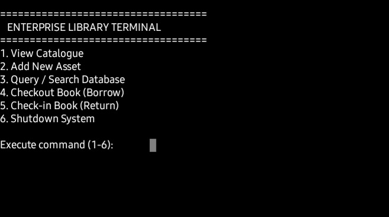
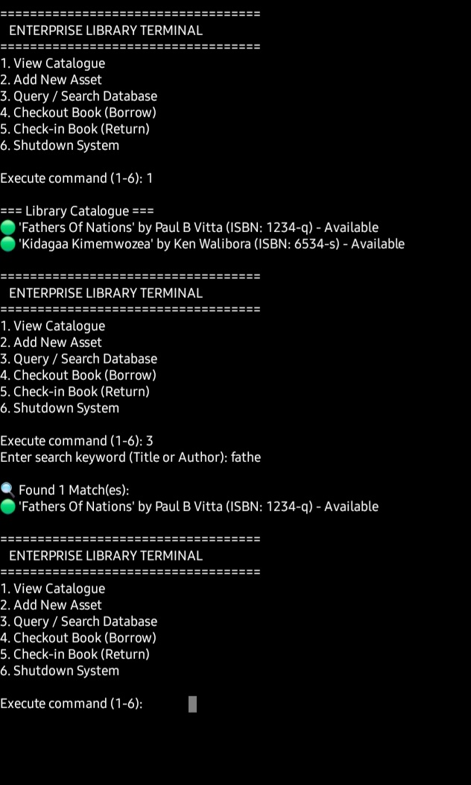
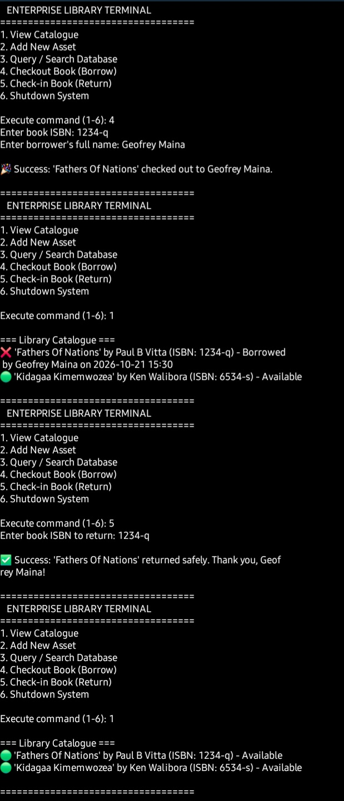

# Enterprise Library Terminal (showcase)

A menu-driven command-line library management system in Python. It tracks a catalogue of books, lets a user add, search, borrow and return them, and saves everything to a JSON file so the data is still there the next time the program runs.

> **The source code is private.** This repository holds the documentation, architecture, screenshots and a short illustrative snippet. See [LICENSE](LICENSE).

**Status:** Completed · **Stack:** Python 3, standard library only (`json`, `os`, `datetime`) · **Style:** object-oriented, command line

## Screenshots

| Main menu | Catalogue and search | Borrow and return |
|---|---|---|
|  |  |  |

## What it does

- Six menu options: view the catalogue, add a book, search, check a book out, check a book in, and shut down.
- Each book records its title, author, ISBN, whether it is borrowed, the borrower's name and the date and time it was taken.
- ISBNs are trimmed and lower-cased before use, so the same ISBN typed with different spacing or case is rejected as a duplicate.
- Search matches part of a title or author, ignoring case.
- Checking out a book stamps the borrower and the time. The program refuses to lend a book that is already out or does not exist, and warns when a book already on the shelf is returned.
- Empty inputs are refused at the menu before anything is changed.
- Every change is saved straight away to `library_data.json`.

## The problem it solves

A library needs to know which books it owns and who has which one. The program tracks that state per book, and it has to keep the saved file usable even when the file is missing, empty or damaged. See [docs/architecture.md](docs/architecture.md).

## Design in one paragraph

Two classes. `Book` holds one record and can turn itself into a dictionary for saving. `Library` owns the catalogue, the saving and loading, and the borrowing rules. The menu loop only collects input and calls `Library`.

## Defensive choices

- A missing or empty save file is treated as an empty library.
- Unreadable or malformed JSON and permission errors produce a warning instead of a crash.
- Records are read with default values, so a book with a missing field loads as "Unknown Title" instead of raising a `KeyError`.
- The borrowed flag is cast to a boolean when a `Book` is created, so loose types from JSON do not leak through.
- File errors while saving are caught and reported to the user.

## Known limits (honest list)

- If the saved file cannot be read, the program starts with an empty library, and the next change would overwrite that file. There is no backup step.
- Saving rewrites the whole file in one step (not atomic), so a crash mid-save could leave a damaged file.
- A file whose top level is not an object (for example a list) is not covered by the error handling.
- `bool()` turns any non-empty text, including "false", into `True`, so a hand-edited file with that text would load a book as borrowed.
- There is no edit or delete, and no due dates or fines.

These are the first things I would fix in a next version.

## Testing and evidence

The details here come from reading the program's source. No automated tests or run records are published for this project.

## Source access

The code is private. I am happy to walk through it or demonstrate the program on request.
