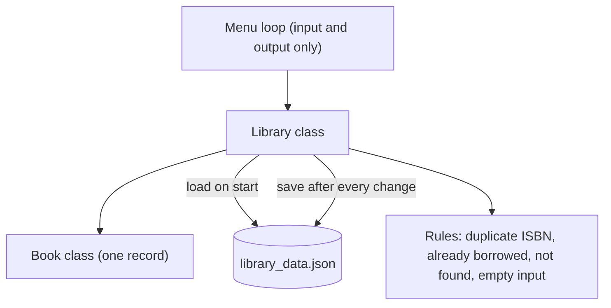

# Enterprise Library Terminal: architecture

## Classes

| Class | Responsibility |
|---|---|
| `Book` | Holds title, author, ISBN, borrowed flag, borrower and time taken; converts itself to a dictionary for saving |
| `Library` | Owns the list of books, loading and saving, search, and the borrowing and return rules |

## Data file

One JSON file holds the list of books. Fields are read with defaults, and the borrowed flag is cast to a boolean when a `Book` is created.

## Flow of a checkout

1. The menu collects an ISBN and a borrower name and refuses empty input.
2. `Library` normalises the ISBN and looks the book up.
3. If the book is missing or already out, the user is told and nothing changes.
4. Otherwise the borrower and time are stamped and the file is saved immediately.

## Why it is split this way

- Rules live in `Library`, not in the menu, so they can be changed or tested without touching input handling.
- A `Book` converting itself to a dictionary keeps the save format in one place.
